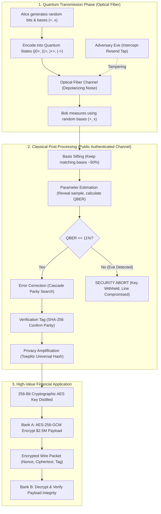

# QBheem: Quantum-Secured Interbank Key Distribution (BB84) & Transaction Defense
## Comprehensive Project Architecture & Technical Guide

---

# TABLE OF CONTENTS
1. [Executive Summary & The "Why"](#1-executive-summary--the-why)
2. [Beginner's Guide: Understanding Quantum Cryptography Simply](#2-beginners-guide-understanding-quantum-cryptography-simply)
   - 2.1 The Problem with Classical Banking (RSA Threat)
   - 2.2 Meet the Characters: Alice, Bob, and Eve
   - 2.3 The "Magic" Physics Laws: No-Cloning & Measurement Collapse
   - 2.4 Why Name it **QBheem**?
3. [Full Technical Architecture & System Design](#3-full-technical-architecture--system-design)
   - 3.1 End-to-End System Pipeline Diagram
   - 3.2 Dual-Engine Simulation (NumPy vs Qiskit)
4. [Deep Dive into Code Modules](#4-deep-dive-into-code-modules)
   - 4.1 Module 1: The Quantum Layer (`quantum.py` & `quantum_qiskit.py`)
   - 4.2 Module 2: Classical Post-Processing (`postprocessing.py`)
   - 4.3 Module 3: Protocol Orchestrator (`protocol.py`)
   - 4.4 Module 4: Application & Financial Payload (`application.py`)
   - 4.5 Module 5: Comparative Cryptographic Baseline (`rsa_baseline.py`)
   - 4.6 Module 6: Empirical Experiments & Telemetry (`experiments.py`)
   - 4.7 Module 7: API Server & Dashboard (`server.py` & `static/index.html`)
5. [Mathematical & Algorithmic Foundations](#5-mathematical--algorithmic-foundations)
   - 5.1 Quantum State Representations
   - 5.2 Why Eve Inevitably Causes 25% Error (Derivation)
   - 5.3 Error Correction via Cascade
   - 5.4 Finite-Key Bounds & Toeplitz Privacy Amplification
6. [Current Limitations & Physics Realities](#6-current-limitations--physics-realities)
7. [Future Enhancements & Roadmap](#7-future-enhancements--roadmap)

---

## 1. Executive Summary & The "Why"

Modern global banking relies heavily on asymmetric public-key cryptography—principally **RSA** and **Elliptic Curve Cryptography (ECC)**—to exchange session keys. However, public-key cryptography is founded upon computational assumptions: factoring large numbers (RSA) or computing discrete logarithms (ECC) is difficult for classical supercomputers.

**The Quantum Threat is Two-Fold:**
1. **Shor’s Algorithm (1994):** Running on a cryptographically relevant quantum computer (CRQC), Shor's algorithm solves prime factorization and discrete logarithms in polynomial time $O((\log N)^3)$, rendering RSA and ECC entirely obsolete.
2. **"Harvest Now, Decrypt Later" (HNDL):** Hostile adversaries and state actors are actively recording encrypted banking traffic *today*. When scalable quantum computers emerge in the future, these archives will be decrypted retroactively.

**QBheem** implements **Quantum Key Distribution (QKD)** via the **BB84 Protocol** (Bennett & Brassard, 1984). Instead of mathematical hardness, BB84 derives **information-theoretic security** directly from the fundamental laws of quantum physics.

---

## 2. Beginner's Guide: Understanding Quantum Cryptography Simply

### 2.1 The Problem with Classical Banking
Imagine Bank A wants to send a secret password to Bank B inside an armored truck on a highway. If a spy taps the highway, copies the password, and puts the paper back, neither Bank A nor Bank B will ever know someone copied it. That is how the internet works today with classical bits ($0$ and $1$).

### 2.2 Meet the Characters
* **Alice (Bank A):** The transmitter who creates random bits, encodes them into quantum light particles (photons), and fires them across an optical fiber.
* **Bob (Bank B):** The receiver who catches the photons and measures them using his own equipment.
* **Eve (The Eavesdropper / Adversary):** A rogue hacker or spy sitting on the fiber line trying to intercept the secret key.
* **QBheem:** The guardian protocol protecting the transaction.

### 2.3 The "Magic" Physics Laws
Quantum particles behave completely differently from everyday objects:

1. **The Observer Effect (Wavefunction Collapse):**
   In quantum physics, you cannot look at a photon without physically touching it and changing its state. If Eve intercepts a photon to read it, she *alters* it.
2. **The No-Cloning Theorem (Wootters & Zurek, 1982):**
   It is physically impossible to make a perfect copy of an unknown quantum state. Eve cannot "photocopy" Alice's photon, keep one copy, and forward the other to Bob. She must guess, measure, and resend.
3. **The Trap:**
   Because Eve cannot clone, when she measures in the wrong basis (which happens 50% of the time), she introduces random noise into the channel. Alice and Bob simply count the errors (QBER). If the error rate spikes, they know an eavesdropper is present and **abort before any money moves**.

### 2.4 Why Name it QBheem?
* **Bheem (The Hero/Protector):** Just like the legendary protector Bheem, this system stands guard between Bank A and Bank B, neutralizing Eve whenever she taps the line.
* **"Q-Beam" (Physics Pun):** Phonetically, it represents the **Quantum Beam** of polarized photons transmitted across the optical waveguide.

---

## 3. Full Technical Architecture & System Design

### 3.2 Dual-Engine Quantum Simulation

QBheem features two interchangeable quantum backends:
1. **NumPy State-Vector Simulator (`qkd/quantum.py`):**
   Simulates pure single-qubit density vectors in Hilbert space $\mathbb{C}^2$. Incredibly fast ($<0.05\text{s}$ per 16,384 qubits), ideal for interactive web dashboard telemetry and Monte Carlo parameter sweeps.
2. **Qiskit Aer Stabilizer Simulator (`qkd/quantum_qiskit.py`):**
   Constructs real quantum circuits using IBM's Qiskit SDK. Since BB84 relies strictly on Clifford gates ($H, X, Z$ and measurement), circuits are executed on `AerSimulator(method="stabilizer")` running the Gottesman-Knill theorem for polynomial-time quantum circuit simulation.

---

## 4. Deep Dive into Code Modules

### 4.1 Module 1: The Quantum Layer
* **Files:** [`qkd/quantum.py`](file:///c:/Users/jahir/Downloads/bb84_bank/bb84_bank/qkd/quantum.py), [`qkd/quantum_qiskit.py`](file:///c:/Users/jahir/Downloads/bb84_bank/bb84_bank/qkd/quantum_qiskit.py)
* **Responsibilities:**
  - Generates uniform random bit vectors: $a \in \{0, 1\}^n$.
  - Generates random basis choices: $0 = \text{Rectilinear } (+), 1 = \text{Diagonal } (\times)$.
  - **State Encoding:**
    $$\text{Bit 0, Basis 0} \rightarrow |0\rangle = \begin{pmatrix} 1 \\ 0 \end{pmatrix}, \quad \text{Bit 1, Basis 0} \rightarrow |1\rangle = \begin{pmatrix} 0 \\ 1 \end{pmatrix}$$
    $$\text{Bit 0, Basis 1} \rightarrow |+\rangle = \frac{1}{\sqrt{2}}\begin{pmatrix} 1 \\ 1 \end{pmatrix}, \quad \text{Bit 1, Basis 1} \rightarrow |-\rangle = \frac{1}{\sqrt{2}}\begin{pmatrix} 1 \\ -1 \end{pmatrix}$$
  - **Channel Noise:** Simulates fiber depolarizing noise where a photon is subjected to random Pauli operators ($X, Y, Z$) with probability $p$.
  - **Eve's Intercept-Resend Attack:** Eve intercepts fraction $f$ of the qubits, measures them in a randomly chosen basis, collapses their wavefunction, and sends newly prepared photons to Bob.
  - **Measurement:** Simulates projective measurement using the Born rule: $P(1) = |\langle 1 | \psi \rangle|^2$.

### 4.2 Module 2: Classical Post-Processing
* **File:** [`qkd/postprocessing.py`](file:///c:/Users/jahir/Downloads/bb84_bank/bb84_bank/qkd/postprocessing.py)
* **Responsibilities:**
  1. **Sifting (`sift`):** Alice and Bob announce their chosen bases over the public classical channel. Where bases match ($b_A == b_B$), bits are retained. In an ideal channel, approximately $50\%$ of raw qubits are retained.
  2. **Parameter Estimation (`estimate_qber`):** A random subset (default $20\%$) of the sifted key is sacrificed and publicly compared to calculate the Quantum Bit Error Rate ($\text{QBER}$). These revealed bits are discarded permanently.
  3. **Error Correction (`cascade`):** Implements an interactive multi-pass Cascade algorithm. Keys are partitioned into blocks of size $k \approx 0.73 / \text{QBER}$. Parities are compared; upon a mismatch, binary search locates and inverts the erroneous bit. Disclosed parity bits are tracked as leaked information.
  4. **Key Verification Tag (`verification_tag`):** Computes a 64-bit HMAC/SHA-256 digest to mathematically confirm Alice and Bob's keys match.
  5. **Privacy Amplification (`toeplitz_hash`):** Eve may have partial knowledge of the key from intercepted photons or disclosed error correction parities. Privacy amplification compresses the key using a random Toeplitz matrix over Galois Field GF(2):
     $$K_{secure} = T \cdot K_{corrected} \pmod 2$$
     This shrinks Eve's mutual information with the final key to exponentially negligible levels ($< 10^{-9}$).

### 4.3 Module 3: Protocol Orchestration
* **File:** [`qkd/protocol.py`](file:///c:/Users/jahir/Downloads/bb84_bank/bb84_bank/qkd/protocol.py)
* **Responsibilities:**
  - Manages the entire session lifecycle via `SessionConfig` and returns structured telemetry via `SessionResult`.
  - Enforces the hard safety rule:
    * If $\text{QBER} > 11\%$, or
    * If final secure key length $< 256$ bits,
    * **Immediately trigger an abort** and refuse to output keys to the application.

### 4.4 Module 4: Application & Financial Payload
* **File:** [`qkd/application.py`](file:///c:/Users/jahir/Downloads/bb84_bank/bb84_bank/qkd/application.py)
* **Responsibilities:**
  - Models high-value bank wire transfer payloads (e.g., Bank A to Bank B for $\$2,500,000.00$ USD with UTC ISO timestamp).
  - Uses the distilled 256-bit quantum key to perform **AES-256-GCM** (Galois/Counter Mode) authenticated encryption.
  - Generates a 96-bit cryptographic nonce and a 128-bit authentication tag to ensure confidentiality, integrity, and authenticity.

### 4.5 Module 5: Comparative Baseline & Quantum Cryptanalysis Engine
* **File:** [`qkd/rsa_baseline.py`](file:///c:/Users/jahir/Downloads/bb84_bank/bb84_bank/qkd/rsa_baseline.py)
* **Responsibilities:**
  - Implements standard RSA-2048 key exchange with full cryptographic tracking (Alice public key $(e_A, N_A)$, Bob session secret $K$, ciphertext $C$, and Alice decryption).
  - Simulates an active **Man-in-the-Middle (MitM)** adversary: Eve intercepts Alice's public key, substitutes rogue key $(e_E, N_E)$, intercepts Bob's ciphertext, extracts the 256-bit AES session key, re-encrypts with Alice's key, and forwards it—all with **0.00% physical signal perturbation**.
  - Generates a chronological 6-step trajectory (`steps`) consumed by the interactive UI stepper to animate packets moving across the wire conduit.
  - Implements **Harvest-Now-Decrypt-Later (HNDL)** and quantum period-finding factoring via Pollard's rho simulation, returning exact primes $p, q$, totient $\phi(N)$, private exponent $d$, decrypted SWIFT payload, and benchmark tables comparing classical factorization ($3.8 \times 10^{14}$ years) vs Shor's algorithm on a 4,096-qubit quantum processor (~10 minutes).

### 4.6 Module 6: Experiments Engine
* **File:** [`qkd/experiments.py`](file:///c:/Users/jahir/Downloads/bb84_bank/bb84_bank/qkd/experiments.py)
* **Responsibilities:**
  - Runs Monte Carlo runs across noise sweeps ($0\%$ to $10\%$) and Eve interception fractions ($0\%$ to $100\%$).
  - Produces data for QBER distribution, key generation efficiency, and security cutoff thresholds.

### 4.7 Module 7: API Server & Dashboard Visual Architecture
* **Files:** [`server.py`](file:///c:/Users/jahir/Downloads/bb84_bank/bb84_bank/server.py), [`static/index.html`](file:///c:/Users/jahir/Downloads/bb84_bank/bb84_bank/static/index.html)
* **Responsibilities:**
  - FastAPI server serving endpoints:
    * `/api/health`: Health status & Qiskit availability.
    * `/api/session`: Executes quantum session (NumPy or Qiskit) with Eve intercept-resend, Cascade error correction, and AES-256-GCM transaction encryption.
    * `/api/experiments/*`: Monte Carlo telemetry sweeps.
    * `/api/rsa?mitm=bool&bits=int`: Returns full RSA handshake trajectory, stolen session keys, and physical disturbance metrics.
    * `/api/rsa/harvest?prime_bits=int`: Simulates Shor factorization, returning prime factors, totient, private key, and decrypted bank wire.
  - **Premium Frontend Visual Architecture:**
    1. **Live Exchange Tab:** Interactive optical fiber SVG with animated photon wave packets, Alice/Bob dual terminals, QBER meter with 11% cutoff tick, sifting funnel, and AES-256-GCM payload inspector.
    2. **Telemetry & Analysis Tab:** Chart.js Monte Carlo empirical sweeps (QBER distributions, key generation efficiency vs noise, and partial interception thresholds).
    3. **QBheem vs Classical RSA Visual Suite:**
       * *Classical RSA & MitM Pipeline:* Animated packet moving across the conduit, Eve's rogue router node with live intercept status, 6-stage interactive stepper (`[Step-by-Step]`, `[◀ Prev]`, `[Next ▶]`, `[Reset]`), 3-panel micro-terminals (Alice, Wire/Eve Sniffer, Bob), and physical disturbance audit ($0.00\%$).
       * *Harvest-Now-Decrypt-Later & Shor's Lab:* 3-era interactive timeline (Present 2026 Archive → Vault Storage → Q-Day 2035), live mathematical factorization cards, decrypted SWIFT payload, and the **QBheem Quantum Immunity Shield**.
       * *Live Head-to-Head Arena:* Side-by-side duel simulator launching concurrent attacks on both systems (Classical RSA silent compromise vs QBheem wavefunction collapse & 25% QBER session abort).
       * *Security Architecture Matrix:* Comparative breakdown of computational vs information-theoretic security.

---

## 5. Mathematical & Algorithmic Foundations

### 5.1 Why Eve Inevitably Causes 25% QBER (Mathematical Proof)

Suppose Alice sends bit $0$ in the Rectilinear basis: $|\psi\rangle = |0\rangle$.

1. Eve intercepts. Since Eve does not know Alice's basis, she chooses randomly:
   - **Case A (50% probability):** Eve chooses Rectilinear ($+$).
     Eve measures $|0\rangle$, gets bit $0$. She resends $|0\rangle$.
     Bob measures in Rectilinear ($+$). Bob gets bit $0$. **Error = 0%.**
   - **Case B (50% probability):** Eve chooses Diagonal ($\times$).
     Eve measures in basis $\{|+\rangle, |-\rangle\}$. The state $|0\rangle = \frac{1}{\sqrt{2}}(|+\rangle + |-\rangle)$.
     Eve measures $|+\rangle$ with prob $0.5$ or $|-\rangle$ with prob $0.5$.
     She resends whatever she measured (e.g. $|+\rangle$).
     Bob now measures in Alice's basis ($+$).
     The probability that Bob gets the wrong bit ($|1\rangle$) is:
     $$P(\text{Bob gets } 1) = |\langle 1 | + \rangle|^2 = \left|\frac{1}{\sqrt{2}}\right|^2 = 0.5$$

2. **Total Expected Error Rate on Matching Bases:**
   $$P(\text{Error}) = P(\text{Case A}) \times 0 + P(\text{Case B}) \times 0.5 = 0.5 \times 0 + 0.5 \times 0.5 = 0.25 = \mathbf{25\%}$$

Even if Eve only taps a fraction $f$ of qubits, the induced error is:
$$\text{QBER} \approx \text{Channel Noise} + (0.25 \times f)$$

Because natural channel noise in quality optical fiber is typically $1\% - 3\%$, Eve's presence causes an unmistakable, statistically significant anomaly!

### 5.2 The 11% Asymptotic Security Threshold
The maximum tolerable error rate for BB84 with one-way classical post-processing is derived from the Shannon-Hartley theorem and the binary entropy function $h_2(p) = -p \log_2(p) - (1-p)\log_2(1-p)$.

The asymptotic secret key rate is given by the Devetak-Winter bound:
$$R = 1 - 2 h_2(\text{QBER})$$
Setting $R = 0$:
$$h_2(\text{QBER}) = 0.5 \implies \text{QBER} \approx 0.1100278 \approx \mathbf{11.0\%}$$
If QBER exceeds $11\%$, Eve's mutual information exceeds Bob's mutual information, making it mathematically impossible to distill an information-theoretically secure key.

### 5.3 Finite-Key Bound Formulation
In real-world implementations, keys are finite. QBheem implements a finite-key length bound:
$$\ell = n \cdot [1 - h_2(q_{upper})] - \text{leak}_{EC} - 2 \log_2\left(\frac{1}{\epsilon_{sec}}\right)$$
Where:
* $n$ is the key length after parameter estimation.
* $q_{upper} = \text{QBER} + \sqrt{\frac{\ln(1/\epsilon_{pe})}{2 n_{sample}}}$ adds a **Hoeffding bound margin** to ensure we do not underestimate QBER due to statistical sample fluctuations.
* $\text{leak}_{EC}$ is the total parity bits disclosed during Cascade.
* $\epsilon_{sec} = 10^{-9}$ is the security failure probability parameter.

---

## 6. Current Limitations & Physics Realities

While QBheem faithfully models the physics and mathematics of BB84, practical quantum systems in the field face several real-world engineering constraints:

| Constraint | Description & Impact |
|---|---|
| **Classical Channel Authentication** | BB84 assumes Alice and Bob have an authenticated classical channel to announce bases. In production, this requires a pre-shared master key using a **Wegman-Carter MAC**. Without authentication, Eve could perform a classical MitM on the basis announcements. |
| **Fiber Attenuation & Distance Limit** | Commercial optical fibers attenuate light at $\sim 0.2\text{ dB/km}$ at $1550\text{ nm}$. Photons are absorbed over long distances. Standard QKD without trusted nodes is practically limited to $\sim 100 - 150\text{ km}$. Classical repeaters cannot be used because amplifiers measure and clone, destroying quantum coherence. |
| **Multi-Photon Pulses & PNS Attacks** | True single-photon sources (attenuated lasers) occasionally emit pulses containing 2 or more identical photons. Eve can split off one photon and let the other pass (Photon-Number Splitting attack). This requires **Decoy-State BB84** in real hardware. |
| **Detector Dead Time & Dark Counts** | Avalanche Photodiodes (APDs) and Superconducting Nanowire Single-Photon Detectors (SNSPDs) register occasional false pulses ("dark counts") due to thermal noise, contributing to baseline QBER. |
| **Side-Channel Hardware Attacks** | Real-world adversaries can exploit optical back-reflections or blind detectors using high-intensity continuous-wave lasers ("detector blinding"). |

---

## 7. Future Enhancements & Roadmap

1. **Decoy-State BB84 Implementation:**
   Introduce decoy pulses of varying light intensities ($\mu, \nu$) to mathematically detect and prevent Photon-Number Splitting (PNS) attacks over attenuated lasers.
2. **Wegman-Carter Universal Hash Authentication:**
   Integrate automated pre-shared key recycling so basis reconciliation and Cascade parities are signed with Carter-Wegman MACs.
3. **PQC + QKD Hybrid Key Agreement:**
   Combine Post-Quantum Cryptography algorithms (e.g., CRYSTALS-Kyber / ML-KEM) with QKD, providing defense-in-depth: computational quantum resistance layered with physical information-theoretic security.
4. **Free-Space & Satellite Quantum Link Simulation:**
   Model atmospheric turbulence, beam diffraction, and Doppler shift for low Earth orbit (LEO) satellite-to-ground quantum communications (similar to the Chinese *Micius* satellite).
5. **Entanglement-Based E91 Protocol Extension:**
   Add support for the Ekert (E91) protocol using entangled EPR pairs and Bell's Inequality ($S \le 2\sqrt{2}$) tests for device-independent QKD.
